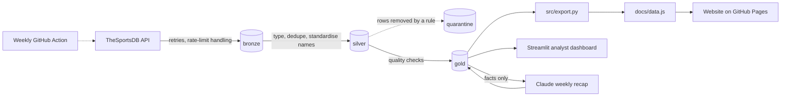

# PSL Form Guide

[](https://github.com/dhludhlazinhle-ops/psl-form-guide/actions/workflows/ci.yml)
[](https://dhludhlazinhle-ops.github.io/psl-form-guide/)

**[Open the live site](https://dhludhlazinhle-ops.github.io/psl-form-guide/)**

An end-to-end data product for the South African Premier Soccer League (PSL): a tested pipeline that ingests match results, models them in a DuckDB warehouse, rates every team with Elo, predicts upcoming fixtures, and serves everything through a fast, club-badge-rich website with a weekly recap written by Claude.

| League table and spotlight | Team page |
|---|---|
|  |  |

## What it answers

- Who is actually in form right now? (last five results for every team)
- How strong is each side, and how has that moved? (Elo rating history)
- Who is likely to win the next fixtures? (win, draw and loss probabilities)
- What happened this week, in plain language? (a Claude-written recap grounded in the numbers)

## Architecture



| Layer | Tables | Purpose |
|---|---|---|
| Bronze | `bronze_events` | Raw API rows, append-only, with a load timestamp. Never edited. |
| Silver | `silver_matches`, `silver_quarantine`, `dim_team`, `dim_team_alias` | Typed, deduplicated, team names standardised. Rows removed by a rule are kept in quarantine with the reason. |
| Gold | `fact_match`, `dim_date`, `gold_league_table`, `gold_form`, `gold_elo_history`, `gold_elo_current`, `gold_fixture_predictions`, `gold_active_teams`, `gold_weekly_recap` | Star schema plus the analytics tables the front ends read. |

Every layer can be rebuilt from the one before it, and the pipeline is safe to run repeatedly.

## Data quality: what the checks caught

The source data is not clean, so the pipeline has to cope with that. As of October 2026, 970 fixtures were fetched across four seasons: 964 are clean and 6 are quarantined.

| Problem found | How it is handled |
|---|---|
| **Stale placeholders.** Rescheduled fixtures appear twice: once played, once "not started" with a new id. | The unplayed copy is quarantined when a played row exists for the same season, home team and away team. |
| **Mirrored duplicate.** One match entered twice on the same day with home and away reversed. | Rows for the same two teams on the same day are collapsed, keeping the played row, then the lowest id. |
| **Club rename.** SuperSport United continues as Siwelele, and the source retitles old matches with the new name. | A tracked mapping table (`seeds/team_aliases.csv`) maps both names to one team, so Elo history carries over. |
| **Inconsistent team names** (`Amazulu`, `AmaZulu FC`, ...). | The same alias table. An unmapped name stops the pipeline with a message listing it. |
| **API rate limiting (HTTP 429).** | Waits for the `Retry-After` period, retries, and saves each season as soon as it is fetched. |

Five quality checks run on every build: missing dates, a team playing itself, goals outside 0 to 15, duplicate match ids, and more than one match per home/away pair per season. If any fails, the pipeline stops before gold is rebuilt, so the front ends keep showing the last good numbers.

## The Elo model

- Every team starts at 1500. After each match the winner takes points from the loser, and the amount depends on how surprising the result was (K = 20).
- The home side gets a 60-point boost when predicting.
- At the start of each season every rating moves 25% back toward 1500, because squads change.
- Ratings only move points between teams, so the average stays at 1500. This is asserted in the tests.
- Win, draw and loss probabilities split the Elo expected score with a simple heuristic: draws are most likely between evenly matched teams. It is not a fitted model.

The constants are standard starting values, not tuned for the PSL. Backtesting them is the obvious next improvement.

## The website

`docs/index.html` is a single self-contained page with no build step and no framework.

- **League table** with podium and relegation-zone markers, form chips and a season selector.
- **Power rankings** with animated Elo bars, five-match rating change and sparklines.
- **Predictions** for every upcoming fixture, with a three-way probability bar and a team filter.
- **Team pages** with an Elo history chart, recent results and next fixtures.
- **Weekly recap** from Claude, with the facts it was written from stored next to the text.
- Club badges come from the raw API data, with a generated crest as a fallback. It is responsive, keyboard accessible, respects reduced-motion settings, and also works when opened straight from disk.

The page reads one generated file, `docs/data.js`, produced by `src/export.py` from the gold tables. There is no server and no live database behind it, so it is free to host.

## Run it

```bash
git clone https://github.com/dhludhlazinhle-ops/psl-form-guide.git
cd psl-form-guide
python3 -m venv .venv
source .venv/bin/activate
pip install -r requirements.txt

python -m src.pipeline --all --export    # first run: fetch every season, build every layer, write docs/data.js
python -m src.pipeline --auto --export   # later: refresh the current season (plus any season that is missing)
python -m pytest -q                      # run the tests
streamlit run dashboard/app.py           # optional analyst dashboard
```

The free API is rate limited. On a shared network, slow the requests down: `PSL_REQUEST_DELAY=7 python -m src.pipeline --all`.

**Weekly recap.** Copy `.env.example` to `.env`, add an `ANTHROPIC_API_KEY`, then run `python -m src.pipeline --skip-ingest --recap --export`. The recap is written only from the numbers in the gold tables. The website and dashboard never call the API themselves.

**Publishing.** The site is served by GitHub Pages from the `docs/` folder on `main`. Open `docs/index.html` in a browser to preview it locally.

**Scheduled refresh.** `.github/workflows/refresh.yml` runs every Monday morning, and on demand from the Actions tab. It restores the warehouse from the Actions cache, fetches the current season and any season that is missing, rebuilds every layer, checks `docs/data.js`, commits it and asks GitHub Pages to rebuild. A failed quality check stops the run before anything is published. To have the weekly recap written automatically, add an `ANTHROPIC_API_KEY` repository secret; without one the refresh simply skips the recap.

**Orchestration.** `flows/pipeline_flow.py` wraps the same steps as a Prefect flow with retries: `python -m flows.pipeline_flow`.

## Project layout

```
src/ingest.py       API client and bronze loading
src/clean.py        bronze -> silver, quarantine and quality checks
src/elo.py          Elo maths (pure functions)
src/model.py        silver -> gold tables and predictions
src/recap.py        weekly recap with Claude
src/export.py       gold -> docs/data.js for the website
src/pipeline.py     ingest -> clean -> model -> recap -> export
docs/               the website (index.html, data.js)
dashboard/app.py    Streamlit analyst dashboard
flows/              Prefect flow
seeds/              team name mapping
.github/workflows/  ci.yml (tests on every push) and refresh.yml (weekly data refresh)
tests/              pytest suite
```

## Limitations and next steps

- Elo constants and the draw heuristic are not tuned. Next: backtest K and home advantage on past seasons.
- Goal margin is ignored, so a 4-0 and a 1-0 move ratings equally.
- One free data source. A second source would allow cross-checking scores.
- The free test API key is shared and rate limited, so a scheduled run can be slow, or fail on a busy day. A paid key would remove that limit.

## Data source and credit

Match data and club badges come from [TheSportsDB](https://www.thesportsdb.com), used through its free test API key. Check their terms before using the data beyond personal projects. Badges belong to their clubs and are shown only to identify them. This project is not affiliated with the PSL or any club. Predictions are statistical estimates, not betting advice.

## Verification Code
WTC-5CW9ALET

