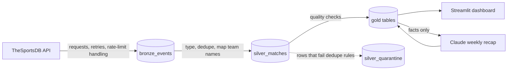

# PSL Form Guide

[](https://github.com/dhludhlazinhle-ops/psl-form-guide/actions/workflows/ci.yml)

An end-to-end data pipeline and analytics app for the South African Premier Soccer League (PSL). It ingests match results, cleans and models them in a warehouse, rates every team with Elo, predicts upcoming fixtures, and serves everything through a dashboard with a weekly recap written by Claude.


## What it answers

- Who is actually in form right now? (last five results per team)
- How strong is each team really, and how has that changed? (Elo rating history)
- Who is likely to win the next fixtures? (win / draw / loss probabilities)
- What happened this week, in plain language? (Claude-written recap, grounded in the numbers)

## Architecture



| Layer | Tables | Purpose |
|---|---|---|
| Bronze | `bronze_events` | Raw API rows, append-only, with a load timestamp. Never edited. |
| Silver | `silver_matches`, `silver_quarantine`, `dim_team`, `dim_team_alias` | Typed, deduplicated, team names standardised. Rows removed by a rule are kept in quarantine with the reason. |
| Gold | `fact_match`, `dim_date`, `gold_league_table`, `gold_form`, `gold_elo_history`, `gold_elo_current`, `gold_fixture_predictions`, `gold_active_teams`, `gold_weekly_recap` | Star schema plus analytics tables the dashboard reads. |

Every layer can be rebuilt from the one before it, and the pipeline is safe to run repeatedly.

## Data quality: what the checks caught

The source data is not clean, and the pipeline has to cope with that. As of October 2026, 970 fixtures were fetched across four seasons. 964 are clean and 6 are quarantined.

| Problem found | How it is handled |
|---|---|
| **Stale placeholders.** Rescheduled fixtures appear twice: once as played, once as "not started" with a new id. | The unplayed copy is quarantined when a played row exists for the same season, home team and away team. |
| **Mirrored duplicate.** One match entered twice on the same day with home and away reversed. | Rows for the same two teams on the same day are collapsed, keeping the played row, then the lowest id. |
| **Club rename.** SuperSport United continues as Siwelele, and the source retitles old matches with the new name. | A tracked mapping table (`seeds/team_aliases.csv`) maps both names to one team, so Elo history carries over. |
| **Inconsistent team names** (`Amazulu`, `AmaZulu FC`, ...). | The same alias table. An unmapped name stops the pipeline with a message listing it. |
| **API rate limiting (HTTP 429).** | Waits for the `Retry-After` period, retries, and saves each season as soon as it is fetched. |

Five quality checks run on every build (missing dates, a team playing itself, goals outside 0 to 15, duplicate match ids, more than one match per home/away pair per season). If any fails, the pipeline stops before gold is rebuilt, so the dashboard keeps showing the last good numbers.

## The Elo model

- Every team starts at 1500. After each match the winner takes points from the loser, and the amount depends on how surprising the result was (K = 20).
- The home side gets a 60-point boost when predicting.
- At the start of each season every rating moves 25% back toward 1500, because squads change.
- Ratings only move points between teams, so the average stays at 1500. This is asserted in the tests.
- Win, draw and loss probabilities split the Elo expected score with a simple heuristic: draws are most likely between evenly matched teams. It is not a fitted model.

The constants are standard starting values, not tuned for the PSL. Backtesting them is the obvious next improvement.

## Run it

```bash
git clone https://github.com/dhludhlazinhle-ops/psl-form-guide.git
cd psl-form-guide
python3 -m venv .venv
source .venv/bin/activate
pip install -r requirements.txt

python -m src.pipeline --all          # first run: fetch every season, build every layer
streamlit run dashboard/app.py        # dashboard at http://localhost:8501
python -m src.pipeline                # later: refresh the current season only
python -m pytest -q                   # run the tests
```

The free API is rate limited. On a shared network, slow the requests down: `PSL_REQUEST_DELAY=7 python -m src.pipeline --all`.

**Weekly recap.** Copy `.env.example` to `.env`, add an `ANTHROPIC_API_KEY`, then run `python -m src.pipeline --skip-ingest --recap` (or `python -m src.recap`). The recap is written only from the numbers in the gold tables, and those facts are stored next to the text so every recap can be audited. The dashboard never calls the API itself.

**Orchestration.** `flows/pipeline_flow.py` wraps the same steps as a Prefect flow with retries: `python -m flows.pipeline_flow`.

## Project layout

```
src/ingest.py       API client and bronze loading
src/clean.py        bronze -> silver, quarantine and quality checks
src/elo.py          Elo maths (pure functions)
src/model.py        silver -> gold tables and predictions
src/recap.py        weekly recap with Claude
src/pipeline.py     ingest -> clean -> model -> recap
flows/              Prefect flow
dashboard/app.py    Streamlit app
seeds/              team name mapping
tests/              pytest suite, run on every push by GitHub Actions
```

## Limitations and next steps

- Elo constants and the draw heuristic are not tuned. Next: backtest K and home advantage on past seasons.
- Goal margin is ignored, so a 4-0 and a 1-0 move ratings equally.
- One free data source. A second source would allow cross-checking scores.
- The dashboard needs a running server. A static export hosted on GitHub Pages would give a permanent public link.

## Data source and credit

Match data comes from [TheSportsDB](https://www.thesportsdb.com), used through its free test API key. Check their terms before using the data beyond personal projects. This project is not affiliated with the PSL or TheSportsDB. Predictions are statistical estimates, not betting advice.
